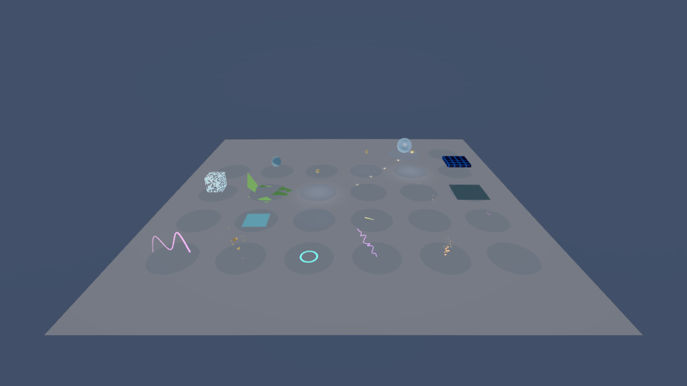

# Scene Effects showcase

Generate a normal Rustic project through the public scene/project APIs:

```sh
CARGO_INCREMENTAL=0 cargo run -p engine-project --profile dev-fast --example scene_effects_showcase -- /tmp/rustic-effects-showcase
```

Run this command from `Engine/`. The destination must be empty; the generator never replaces an existing project. Open the generated `project.engine` through Project Manager. The scene contains numbered entities for all 26 component types, targets and lights, a moving Lua trail/ripple demonstration, a replay controller, an animated energy-grid texture, procedural debris/foliage OBJ meshes, a baked HDR probe panorama and 35 editable `.effect` assets with authoritative `.rmeta` sidecars. The generator reloads its checksummed scene and verifies 26 distinct effect types before succeeding.

Select an effect in the hierarchy and use Properties to change settings. **Effect preview** contains Play/Pause/Resume/Stop/Restart/Reset, frame stepping, speed, deterministic time replay, bounds and metrics. Press Play to run the attached orbit behavior and scene effects. Click the Play viewport to focus it, then press **ArrowUp** to restart all scene effects; holding the key triggers one restart until released. The replay controller uses the supported input API and caches the generated effect IDs. Restart one-shot effects from preview. Stop Play before saving authored changes.

The Inspector's **Effects presets & assets** loads/saves assets and instantiates child groups. Select a composite group to edit its child timeline; source children expose restoring asset defaults and updating the shared source file. Built-in presets are editable authored data with no external downloads or hotlinked assets. Explosion includes delayed smoke, debris, a light flash, camera impulse, parameter bindings, an event track and a generated WAV cue; the generator installs its stable-ID WAV and OBJ resources. Object dissolve and Character highlight include demonstration meshes and self-remapped targets.

Read `docs/SCENE_EFFECTS.md` and `docs/SCENE_EFFECTS_RESEARCH.md` for API setup, compatibility and the acceptance audit. A scene containing all 26 registered components does not prove every requested advanced renderer capability is implemented. The native path includes capability-gated persistent GPU particles, six-face probe capture, temporal fog/shaft history and object/camera motion-vector blur. The particle station requests Auto with a 10,000-particle capacity; WebGL uses the explicit CPU fallback. Unsupported particle modules report their fallback reason in the Inspector. Native/device/browser visual validation is separate from scene load and CPU tests.

The gallery uses a compact lit stage with amber particles/debris/tracer, cyan trails, violet beam/tube effects, teal waves and translucent blue rain. Target meshes appear only in the surface/highlight/probe demonstrations.

Three companion emitters use dedicated layers to demonstrate vortex force, local wind and collision bounce within their stations. The gallery has 29 effect components covering all 26 types. Screen flash and camera impulse finish after one second; ArrowUp restarts their playback along with the other stations.

Rendered gallery, captured from the serialized scene using the Vulkan renderer:



The real browser preset gallery is exported by `tools/browser-tests/effects_fixture.rs::write_browser_presets_fixture`. After building the shipped WebAssembly runtime, run `npm run test:presets` from `tools/browser-tests`. Set `RUSTIC_BROWSER_PRESETS_ARTIFACT_DIR` to retain early/late screenshots and measured pixel differences for all 35 presets. The test selects one spatially isolated station at a time and compares active output with its stopped baseline; short bursts pause at 0.1 seconds for inspection. These artifacts establish actual output; they are separate from subjective art review.
